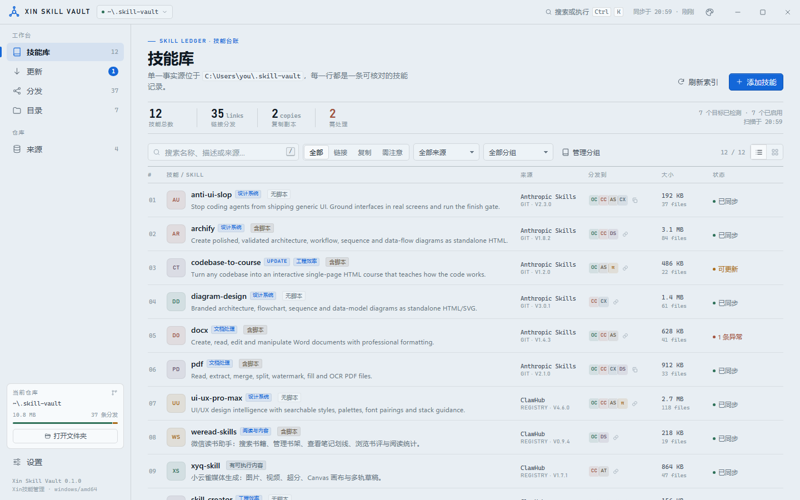
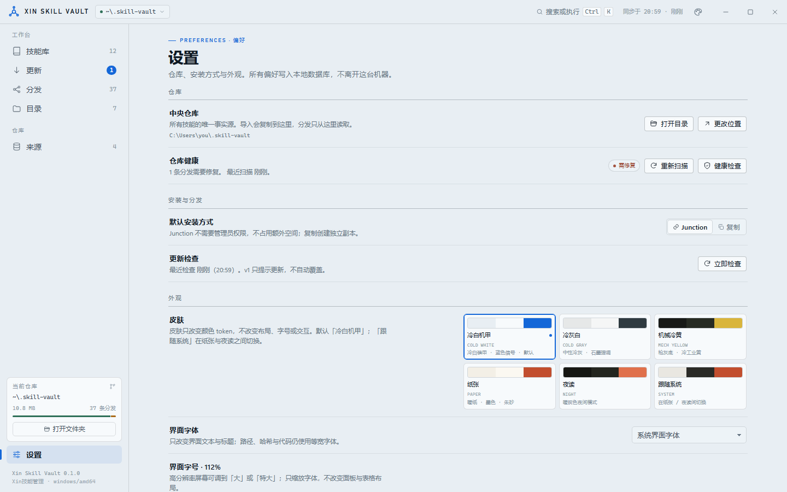
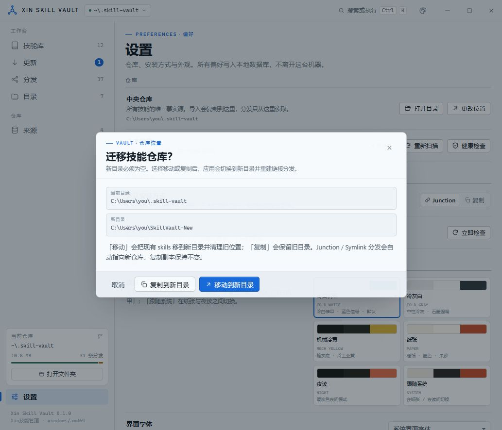

# Xin Skill Vault · Xin 技能管理

> 把散落在各个 Agent 目录里的 Skills 统一管理：集中收录、按需分发，一处更新，多处生效。

[](#下载)
[](https://github.com/oscar-wang-xin/xin-skill-vault/releases)
[](LICENSE)
[](#设计原则)

[官网](https://app.zhi-wo.com/app/xin-skill-vault/) · [下载](#下载) · [使用](#使用) · [构建](#从源码构建) · [GitHub](https://github.com/oscar-wang-xin/xin-skill-vault)



## 简介

**Xin Skill Vault** 是一个本地优先的 Agent Skill 中央仓库管理器。它不绑定某个 Agent，而是把 OpenCode、Claude Code、Codex、Cursor、WorkBuddy、Alma、Cherry Studio 等工具的 skills 目录统一接到一个中央仓库：

- 技能只在仓库里保存一份，避免每个 Agent 各复制一份。
- 分发到 Agent 时优先使用 **Junction**（Windows，无需管理员权限），也可以使用 Symlink 或复制独立副本。
- 目录、分发、备注、标签、组合、提示词和来源全部在本地管理，不上传、不需要账号。
- 支持项目级 skills 目录，例如 `D:\app\.agents\skills`。

本项目不是 Skill 运行时，也**不会执行**任何技能内容。它只负责文件、链接和元数据。

## 功能

### 中央仓库与多来源收录

- 默认仓库位置：`%USERPROFILE%\.skill-repo`，可在设置中更改。
- 导入本地文件夹、ZIP、`.skill` 和 Bundle。
- 扫描本机 Agent 目录，识别未导入/有变更的技能。
- 市场安装：SkillHub 与 skills.sh。
- 每个技能计算 SHA256 内容指纹，SQLite 仅作为可重建索引。

### 分发与目录管理

- 单个技能或整组技能批量分发到多个 Agent / 项目。
- Windows 使用 Junction；失败回退 Symlink；再失败自动复制。
- 项目级技能目录，例如：
  - `<project>/.claude/skills`
  - `<project>/.cursor/skills`
  - `<project>/.agents/skills`
- 查看每个安装件的模式、路径与健康状态。
- 支持单个/批量移除分发。

### 版本、快照与漂移

- 编辑 `SKILL.md` 前自动生成快照。
- 扫描结果覆盖更新前保存完整目录 zip 快照。
- 恢复技能快照，不会静默丢失当前版本。
- 检测三类漂移：
  - 仓库已更新
  - 安装件被本地修改
  - 安装件缺失
- 单条或批量修复；复制件修复前自动备份。

### 组合、Bundle 与提示词

- **组合**：把技能编成组合，一键复用分发弹层。
- **Bundle**：持久化多个技能，重复导出为可分发包；支持 Bundle 导入。
- **提示词**：分类树、同级拖动、Markdown 编辑器、版本历史；每个版本独立保存为 `.md` 文件。
- **标签与笔记**：标签词典、标签筛选、技能笔记。

### 桌面体验

- 六套主题与拟态/线性两套质感。
- 侧栏可折叠，项目左列可拖宽。
- `Ctrl/Cmd+K` 命令面板。
- 诊断包导出：应用信息、配置、日志，不包含技能正文。
- 本地优先：没有账号、没有遥测、没有云端依赖。



## 下载

- **项目主页**：<https://app.zhi-wo.com/app/xin-skill-vault/>
- **GitHub Releases**：<https://github.com/oscar-wang-xin/xin-skill-vault/releases/latest>
- 构建产物不提交到 Git 仓库；请从 Releases 下载，或按下方说明从源码构建。

| 平台 | 发布文件 | 说明 |
|---|---|---|
| Windows 10 / 11 x64 | `XinSkillVault-0.1.1-win-x64.zip` | 解压后运行 `xinskillvault.exe`；需要 WebView2 Runtime |
| macOS / Linux | 源码构建 | 当前未提供官方发布包 |

> 当前 Windows 构建未做代码签名，SmartScreen 可能提示确认。

## 使用

### 首次启动

1. 启动应用：Windows 使用 `xinskillvault.exe`。
2. 应用会在 `~/.skill-repo`（Windows 为 `%USERPROFILE%\.skill-repo`）创建中央仓库。
3. 点击「导入目录」或「ZIP」：
   - 导入本地技能目录
   - 导入 `.zip` / `.skill` 包
   - 导入 Bundle
4. 在「发现」页扫描本机 Agent 目录。
5. 在技能详情中查看文件、指纹、标签、笔记和分发状态。
6. 按需分发到 Agent 或项目目录。

### 仓库位置

设置 → 路径：

- 仓库：默认 `%USERPROFILE%\.skill-repo`
- 提示词：默认 `~/.xin-skill-vault/prompts`
- 配置文件：`%APPDATA%\XinSkillVault\config.json`

修改仓库位置后，请确认已有的 Junction / Symlink 分发是否仍指向有效目录。



## 从源码构建

### 环境

- Go 1.26+
- Node.js 20+
- Wails v3.1.0
- Windows 10 / 11（当前主要目标）

### 开发

```powershell
wails3 task dev
```

### 测试

```powershell
go test ./internal/...
```

### 构建

```powershell
wails3 build
# -> bin/xinskillvault.exe
```

### Windows 免安装包

```powershell
powershell -NoProfile -ExecutionPolicy Bypass -File scripts/package-windows.ps1 -Version 0.1.1
# -> bin/release/XinSkillVault-0.1.1-win-x64.zip
```

### 前端预览

没有 Wails 宿主时，前端会使用 mock 配置，不写真实文件：

```powershell
cd frontend
npm ci
npm run dev
```

## 项目结构

```text
xin-skill-vault/
├─ README.md
├─ LICENSE
├─ assets/                     # README 截图
├─ main.go                     # Wails 启动与依赖装配
├─ internal/
│  ├─ app/                     # Wails 服务、项目、市场、提示词、Bundle
│  ├─ agent/                   # Agent 适配器与目录检测
│  ├─ config/                  # 配置读写
│  ├─ distribute/              # 分发、漂移检测与修复
│  ├─ market/                  # SkillHub / skills.sh Provider
│  ├─ scan/                    # Agent 目录扫描
│  ├─ skill/                   # SKILL.md 解析、slug、指纹
│  ├─ skillpack/               # .skill / Bundle 打包
│  ├─ store/                   # SQLite 迁移与索引
│  └─ vault/                   # 仓库导入、编辑、快照、回收站
├─ frontend/                   # Vue 3 + TypeScript + Vite
├─ examples/demo-skill/        # 可导入示例技能
├─ brand/                      # 标识与图标资源
├─ docs/architecture.md        # 架构说明
├─ build/                      # Wails 平台打包脚手架
└─ scripts/                    # 图标与发布构建脚本
```

## 设计原则

- **本地优先**：没有账号，没有遥测，没有云端依赖。
- **仓库是唯一事实源**：技能内容只保留一份。
- **不执行内容**：只管理文件与链接，不运行技能。
- **可恢复**：删除索引可以从文件系统重建。
- **安全导入**：ZIP / Bundle 有路径穿越与体积防护；市场安装有静态审计。
- **Windows 优先，但不锁死 Windows**：核心代码保留 macOS / Linux 的 Symlink 路径。

## 路线图

- [x] v0.1.1：中央仓库、目录/ZIP/Bundle 导入、扫描发现、Junction/Copy 分发、项目模块、提示词、组合、标签、笔记、市场与诊断包。
- [ ] URL / Git 仓库导入。
- [ ] 应用内更新检查。
- [ ] macOS / Linux 官方构建与签名。
- [ ] 笔记双链与更多组织能力。

## 贡献

欢迎提交 Issue 和 Pull Request：

- Bug / 功能建议：<https://github.com/oscar-wang-xin/xin-skill-vault/issues>
- 提交前请先运行 `go test ./internal/...` 和 `npm run build`。
- 不要提交本地仓库数据、构建产物、个人路径或密钥。
- 内部原型、开发计划和评审资料不会进入公开仓库。

## License

MIT © 2026 Xin Skill Vault contributors

---

## English overview

**Xin Skill Vault** is a local-first desktop manager for Agent Skills. It keeps one central vault (`~/.skill-repo` by default), imports skills from folders, ZIP / `.skill` packages, Bundles, existing Agent installs and selected markets, then distributes them through Windows Junctions, Symlinks or copies.

It includes project-level skill directories, content snapshots, drift detection and repair, reusable skill combos, Bundles, a Markdown prompt library with version history, tags, notes, market search with security auditing, and diagnostics export.

The app is local-first: no account, no telemetry, no cloud dependency. Built with Go + Wails v3 + Vue 3/TypeScript. Licensed under MIT.
