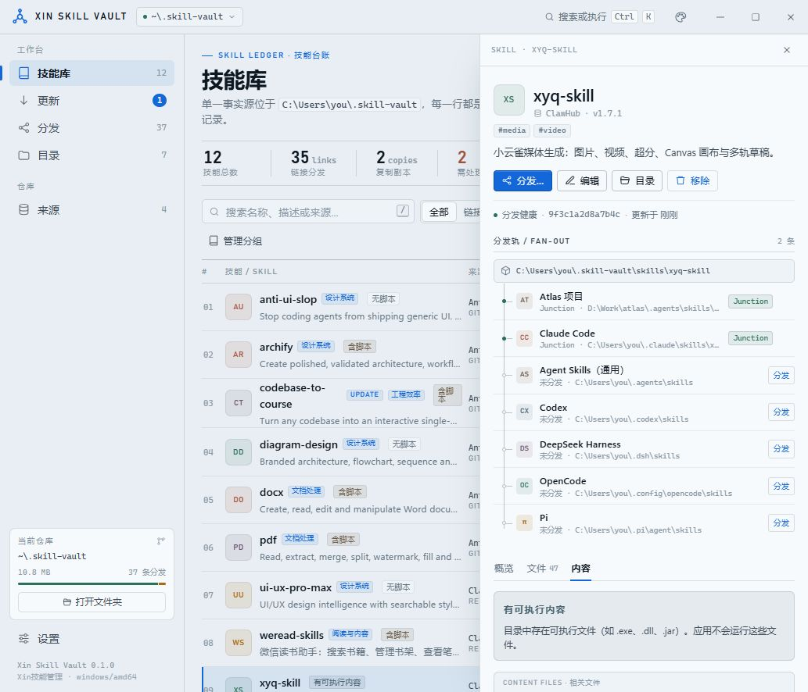

# Xin Skill Vault · Xin技能管理

> 把散落在各个 Agent 目录里的 Skills 统一管理：集中收录、按需分发，一处更新，多处生效。

[](#下载)
[](#路线图)
[](LICENSE)
[](#设计原则)

[官网](https://app.zhi-wo.com/app/xin-skill-vault/) · [下载](#下载) · [使用](#使用) · [构建](#从源码构建) · [GitHub](https://github.com/oscar-wang-xin/xin-skill-vault)


## 简介

**Xin Skill Vault** 是一个 Windows-first 的 Agent Skill 仓库管理器。它不绑定某个 Agent，而是把 OpenCode、Claude Code、Codex、Cursor、Windsurf 等工具的 skills 目录统一接到一个中央仓库：

- 技能只在仓库里保存一份，避免每个 Agent 各复制一份。
- 分发到 Agent 时优先使用 **Junction**（Windows，无需管理员权限），也可以复制独立副本。
- 目录、分发、备注、标签、分组和来源全部在本地管理，不上传、不联网、不需要账号。
- 支持项目级 skills 目录，例如 `D:\app\.agents\skills`。

本项目不是 Skill 运行时，也**不会执行**任何技能内容。它只负责文件、链接和元数据。

## 功能

### 中央仓库与多来源收录

- 默认仓库位置：`%USERPROFILE%\.skill-vault`，可在设置中更改。
- 导入本地文件夹：递归发现所有包含 `SKILL.md` 的目录，支持多选。
- 扫描现有安装：从 Agent / 项目目录导入，Junction / Symlink 会追溯到真实源目录，不会把链接本身复制进仓库。
- 网络导入：GitHub 仓库、GitHub `/tree/分支/子目录`、raw `SKILL.md`、zip、tar.gz。
- 手动维护来源：本地目录、Git 仓库、注册表、URL。

### 分发与目录管理

- 单个技能或整组技能批量分发到多个 Agent / 项目。
- Windows 使用 Junction；macOS / Linux 后续使用 Symlink；也可以选择 Copy。
- 目录管理页可以查看每个 Agent / 项目目录中的技能：
  - 已纳入仓库的链接 / 副本
  - 外部真实目录
  - 外部链接
  - 断链
- 支持从目录导入、从仓库添加、移除、切换 Junction / Copy、打开目录。

### 台账式管理

- 技能备注、标签、分组，全部保存在本地索引中，不修改 `SKILL.md`。
- 搜索、筛选（全部 / 链接 / 复制 / 需处理 / 来源 / 分组）。
- 表格与卡片两种布局。
- 内容检查器：文件列表、内容构成、分发状态、哈希。

### 内容标签，不做风险评分

仓库只做**事实性内容识别**，不判断“高风险 / 低风险”，也不会拦截导入：

| 标签 | 含义 |
|---|---|
| **有可执行内容** | 目录中存在 `.exe`、`.dll`、`.jar` 等可执行文件 |
| **含脚本** | 目录中存在 `.ps1`、`.bat`、`.sh`、`.py`、`.js` 等脚本文件 |
| **无脚本** | 未发现脚本或可执行文件，内容以文档、配置和静态资源为主 |

鼠标悬停标签可以查看具体文件。应用不会读取或执行这些文件的内容。



### 仓库位置可迁移

设置 → 仓库 → **更改位置**：

1. 选择一个空目录。
2. 选择「移动」或「复制」现有 skills。
3. 应用会切换到新目录并自动重建 Junction / Symlink 分发；复制副本保持不变。

### 桌面体验

- 系统托盘图标：显示主窗口、隐藏到托盘、退出。
- 首次关闭窗口时询问：直接退出 / 最小化到托盘，可记住选择。
- 设置中可固定为「询问 / 直接退出 / 最小化到托盘」。
- 六套皮肤：冷白机甲、冷灰白、机械冷黄、纸张、夜读、跟随系统。
- 界面字体与字号可配置：系统界面 / Segoe UI / 微软雅黑 / Noto Sans SC；小 / 标准 / 大 / 特大。
- `Ctrl+K` 命令面板，`Ctrl+N` 添加技能，`F5` 刷新，`Esc` 关闭弹层。


## 下载

- **项目主页**：<https://app.zhi-wo.com/app/xin-skill-vault/>
- **GitHub Releases**：<https://github.com/oscar-wang-xin/xin-skill-vault/releases>
- 构建产物不提交到 Git 仓库；请从 Releases 下载，或按下方说明从源码构建。

| 平台 | 发布文件 | 说明 |
|---|---|---|
| Windows 10 / 11 x64 | `XinSkillVault-0.1.0-windows-amd64.zip` | 解压后运行 `XinSkillVault.exe`；需要 WebView2 Runtime |
| macOS 12+ Universal | `XinSkillVault-0.1.0-macos-universal.zip` | Apple Silicon + Intel；未签名，首次打开需右键「打开」 |
| Linux x64 | `XinSkillVault-0.1.0-linux-amd64.tar.gz` | 需要 GTK4 + WebKitGTK 6.0 运行库；解压后运行 `XinSkillVault` |

> 当前构建均未做代码签名。Windows SmartScreen 可能提示确认；macOS Gatekeeper 可能阻止首次启动。
>
> macOS / Linux 构建使用 Wails v3 的 purego 后端。Linux 运行依赖示例：Ubuntu 24.04 `libgtk-4-1`、`libwebkitgtk-6.0-4`；Fedora `gtk4`、`webkitgtk6.0`。

## 使用

### 首次启动

1. 启动应用：Windows 使用 `XinSkillVault.exe`，macOS 使用 `Xin Skill Vault.app`，Linux 使用 `XinSkillVault`。
2. 应用会在 `~/.skill-vault`（Windows 为 `%USERPROFILE%\.skill-vault`）创建中央仓库。
3. 点击「添加技能」：
   - 从本地文件夹导入
   - 扫描现有 Agent 安装
   - 从 GitHub / zip / tar.gz 导入
4. 在右侧检查器查看内容构成、文件列表和分发状态。
5. 按需分发到 Agent 或项目目录。

### 更改仓库位置

1. 打开「设置 → 仓库」。
2. 点击「更改位置」，选择一个新的空目录。
3. 选择「移动到新目录」或「复制到新目录」。

移动会清理旧目录中的 `skills`；复制会保留旧目录。两种方式都会把链接分发重新指向新仓库。


## 从源码构建

### 环境

- Go 1.26+
- Node.js 20+
- Wails v3 CLI
- Windows 10 / 11（当前主要目标）

### 开发

```powershell
cd src
wails3 dev
```

### 测试

```powershell
cd src
go test ./internal/...
```

### 构建

```powershell
cd src
wails3 build
# -> src/bin/XinSkillVault.exe
```

### 前端预览

没有 Wails 宿主时，前端会使用 `src/frontend/src/lib/mock.ts` 中的模拟数据：

```powershell
cd src/frontend
npm install
npm run dev
```

## 项目结构

```text
skill-hub/
├─ README.md
├─ LICENSE
├─ assets/                     # README 截图
├─ src/                        # Wails 应用
│  ├─ main.go                  # 启动、托盘、窗口
│  ├─ internal/
│  │  ├─ vault/                # 仓库、导入、链接、目录
│  │  ├─ store/                # 本地索引与迁移
│  │  ├─ service/              # Wails AppService
│  │  └─ netimport/            # GitHub / zip / tar.gz
│  ├─ frontend/                # Vue 3 + TypeScript + Vite
│  └─ build/                   # 图标与平台打包脚手架
└─ .gitignore
```

## 设计原则

- **本地优先**：没有账号，没有遥测，没有云端依赖。
- **仓库是唯一事实源**：技能内容只保留一份。
- **不执行内容**：只管理文件与链接，不运行技能。
- **内容识别是事实，不是评分**：只标记“有可执行内容 / 含脚本 / 无脚本”。
- **可恢复**：删除本地索引后可以从仓库目录重建。
- **Windows 优先，但不锁死 Windows**：核心代码为 macOS / Linux 预留了 Symlink 路径。

## 路线图

- [x] v0.1：Windows 桌面端、中央仓库、Junction / Copy 分发、内容标签、托盘、可迁移仓库。
- [ ] 来源同步与更新检查（Git / registry）。
- [ ] 更新确认、差异查看、回滚。
- [ ] macOS / Linux 构建与打包。
- [ ] 代码签名与自动更新。
- [ ] 导入 / 导出与团队共享清单。

## 贡献

欢迎提交 Issue 和 Pull Request：

- Bug / 功能建议：<https://github.com/oscar-wang-xin/xin-skill-vault/issues>
- 提交前请先运行 `go test ./internal/...` 和 `npm run build`。
- 不要提交本地仓库数据、构建产物、个人路径或密钥。

## License

Apache-2.0 © Xin Skill Vault contributors

---

## English overview

**Xin Skill Vault** is a Windows-first desktop manager for Agent Skills. It keeps one central vault (`~/.skill-vault` by default), imports skills from folders, existing Agent installs, GitHub, zip or tar.gz, and distributes them with Windows Junctions or copies. Skills can be grouped, tagged, annotated and inspected without executing their contents. The vault location is configurable and can be moved or copied to a new directory.

The app is local-first: no account, no telemetry, no cloud dependency. Built with Go + Wails v3 + Vue 3/TypeScript. Licensed under Apache-2.0.
